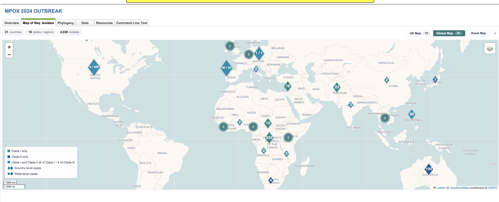
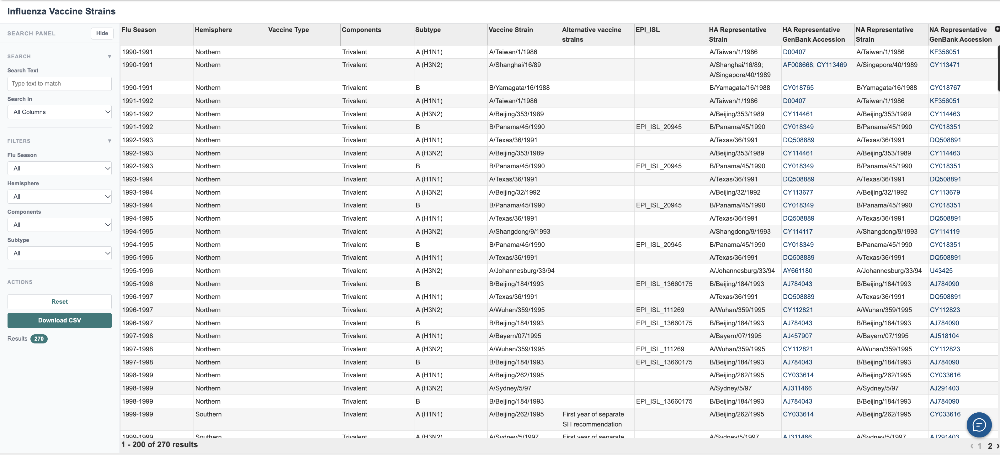

BV-BRC Web Update: New Influenza Search Features, Expanded Viral Analysis, and Improved Workflows
=================================================================================================

**October 2026 | BV-BRC Web Version 3.59.14**

The Bacterial and Viral Bioinformatics Resource Center (BV-BRC) has introduced several updates to improve how researchers search, analyze, and visualize pathogen genomic data. The latest web release includes new influenza search capabilities, expanded Sequence Feature Variant Type (SFVT) analysis, improvements to protein structure prediction workflows, and updates to outbreak and surveillance maps.

These enhancements are designed to make BV-BRC tools more accessible, flexible, and efficient for researchers working with bacterial and viral genomic data.

New Influenza Search Capabilities
---------------------------------

A dedicated **Influenza Search** interface provides researchers with additional options for exploring influenza genomic data. Users can now search across multiple influenza viruses and genome segments, use multiple taxonomy keywords, and more easily organize their results.

The updated interface also includes improved options for customizing search results. Using the **Select Columns** button above the results table, researchers can choose which data fields are displayed, allowing them to focus on information most relevant to their analysis. Selected search options can also appear as default columns in the results.

Additional interface improvements provide better support for different screen sizes and web browsers. A full step by step tutorial is below please check it out and give us any feedback as needed. 

Expanded Sequence Feature Variant Type (SFVT) Analysis
-------------------------------------------------------

BV-BRC has expanded its **Sequence Feature Variant Type (SFVT)** functionality to include data for **Ebola virus**.

.. image:: https://colony-recorder.s3.us-west-1.amazonaws.com/files/2026-10-14/218ded48-dd73-43cd-b580-88d03522a90b/action-92c1018840684e04914015b90b9fcccc_94f410e631d048249467b348d58832f0_text_export.jpeg
   :width: 600
   :alt: BV-BRC Sequence Feature Variant Types interface
   :align: center

SFVT analysis helps researchers examine combinations of amino acid
variations within defined sequence features. The expanded coverage
provides additional opportunities to investigate viral sequence
variation and compare biologically relevant features across sequences.

Researchers can explore the expanded functionality through the
`BV-BRC SFVT Search <https://www.bv-brc.org/searches/SFVTSearch>`_,
which provides access to sequence feature variation data across
supported viruses.

.. image:: https://colony-recorder.s3.us-west-1.amazonaws.com/files/2026-10-14/cdd7178d-fd69-48fe-b81b-df70f0911d97/action-5395b461f59347b8b101c34b4cd3ccd2_f082aa7696a244b0bbec8f7514f85b85_text_export.jpeg
   :width: 600
   :alt: Ebola virus overview in BV-BRC
   :align: center

The newly available Ebola virus data can be explored directly
through the `Ebola SFVT page
<https://www.bv-brc.org/view/Taxonomy/3044781?#view_tab=sfvt>`_,
where users can investigate sequence feature variation within
the available Ebola virus datasets.

.. image:: https://colony-recorder.s3.us-west-1.amazonaws.com/files/2026-10-14/4baef87e-833a-40eb-b405-125b60941aaa/action-beaa2030a2f844f2a4758e085666e9b2_06bfd1326b5f437eb2f9caddbbae5d37_text_export.jpeg
   :width: 600
   :alt: Ebola virus Sequence Feature Variant Types data
   :align: center

The SFVT interface has also received improvements to gene-product selection, data loading, and overall responsiveness, making it easier to navigate available data.

Updates to Protein Structure Prediction
----------------------------------------

The **Predict Structure** service submission form has been redesigned to provide a clearer and more intuitive experience when configuring structure prediction jobs.

Updates include improved ligand input options, controls for selecting multiple sequence alignment (MSA) sources, and a new **Job Name** field that previews the output location before submission.

The prediction tool selection has also been updated to include **ESMFold2**, while AlphaFold 2 has been removed from the available options. Additional guidance has been added to help users understand runtime expectations, MSA settings, and submission requirements.

Improved Outbreak and Surveillance Maps
----------------------------------------

BV-BRC has updated its outbreak and surveillance maps by transitioning from Google Maps to **Leaflet**, an open-source mapping library.

The transition includes refreshed map styling, improved legend organization, and updates to the underlying mapping components. These changes support a more consistent experience when exploring geographic and surveillance information associated with pathogen outbreaks.

New Sequence Selection and Results Customization
------------------------------------------------

The updated Influenza Search interface introduces new options for
selecting sequences and customizing search results. The **Select
Columns** feature allows users to choose which metadata fields
are displayed in the results table, making it easier to focus
on relevant genomic and epidemiological information.

.. image:: https://colony-recorder.s3.us-west-1.amazonaws.com/files/2026-10-14/2d45a217-db3f-4231-bf13-bc8228841017/action-17b6fd7165e540919bc09b9c47cb1020_072113bec27c42d4b97f2f0468946f84_text_export.jpeg
   :width: 600
   :alt: BV-BRC Influenza Search sequence selection and results customization
   :align: center

Additional Updates and Improvements
-----------------------------------

This release also includes several other enhancements across BV-BRC:

* **Influenza B Subspecies Classification:** Additional Influenza B
  options are now available in the
  `Subspecies Classification Service <https://www.bv-brc.org/app/SubspeciesClassification>`_.

* **Influenza Vaccine Strain Information:** A new
  `Influenza Vaccine Strain page <https://www.bv-brc.org/view/VaccineStrain>`_
  provides access to influenza vaccine strain information and
  feature highlights.

* **Workspace Improvements:** Fixes to workspace selection, output
  folder navigation, and favorites management. Users can access
  their files through the
  `BV-BRC Workspace <https://www.bv-brc.org/workspace>`_.

* **Homology and BLAST:** Improvements to metadata retrieval, large
  result handling, and workspace navigation. Explore the
  `BLAST Search <https://www.bv-brc.org/app/BLAST>`_
  tool for sequence similarity analysis.

* **Search and Filtering:** Corrections to Collection Year filtering,
  results display, and data retrieval.

* **Platform Reliability:** Security updates, dependency upgrades,
  and infrastructure improvements to support a more stable user
  experience.

Explore the Latest Updates
--------------------------

These updates reflect BV-BRC's continued commitment to providing accessible bioinformatics resources for the infectious disease research community.

Researchers are encouraged to explore the updated tools and features at `www.bv-brc.org <https://www.bv-brc.org/>`_.

For questions, feedback, or assistance with BV-BRC services, please contact the **BV-BRC Help Desk** through the website.

Understanding the New Influenza Search Functionality
----------------------------------------------------

Learn how to filter and retrieve specific genomic data for H5N1 avian influenza strains using the BV-BRC platform. This example shows how to narrow results by host group, subtype, H5 clade, and location, then export DNA FASTA sequences for research.

You can also follow the `illustrated step-by-step guide <https://scribehow.com/o/B2SvvvDxRYevUXP7yx12ig/viewer/Searching_and_Exporting_Avian_Influenza_Data_on_BV-BRC__9jHW4v4KRbS4tdbS4Bn_tg>`_.

Configure Search Filters
~~~~~~~~~~~~~~~~~~~~~~~~

1. Open **Influenza (BETA)** in BV-BRC.

   .. image:: https://colony-recorder.s3.us-west-1.amazonaws.com/files/2026-10-14/b505a8ce-6482-4b6f-a15a-67d0ec51c4cc/action-d595daa5c71d4a87b96bf12d6ee21f7d_38c8644436094cb6a231ef8ebcad070f_text_export.jpeg
      :alt: Influenza (BETA) search entry
      :width: 650px

2. In **Host Group**, enter ``av`` and select **Avian**.

   .. image:: https://colony-recorder.s3.us-west-1.amazonaws.com/files/2026-10-14/f86f7cbd-b3e4-4d17-83d7-07868d743989/action-ab92a2a70d2e435ab8776f5bac9b4695_cfcf645470ac4fe8831f8a93fd244e79_text_export.jpeg
      :alt: Select Avian as the host group
      :width: 650px

3. In **H Subtype**, select **H5**.

   .. image:: https://colony-recorder.s3.us-west-1.amazonaws.com/files/2026-10-14/1a3f981f-43c3-426a-8844-76c6896c084b/action-b5dbe49236bd450b8863c9b9b7fc2165_10af712065ea4638a51310d2ed916e4a_text_export.jpeg
      :alt: Select H5 subtype
      :width: 650px

4. In **N Subtype**, select **N1**.

   .. image:: https://colony-recorder.s3.us-west-1.amazonaws.com/files/2026-10-14/d61449ab-a243-4c68-a36e-bbcd916ccabf/action-f5a04850ea7743dca3fd42885b18bf98_1aa09b20768148aeb49c00d8343187fe_text_export.jpeg
      :alt: Select N1 subtype
      :width: 650px

5. In **H5 Clade**, select **2.3.4.4b**.

   .. image:: https://colony-recorder.s3.us-west-1.amazonaws.com/files/2026-10-14/63b90218-3d76-4484-81f2-e313ad950d86/action-fddfe0d398194c4498720f515bb9e291_7130a4527e0a4a06827b39c1b4a84d71_text_export.jpeg
      :alt: Select H5 clade 2.3.4.4b
      :width: 650px

6. In **State**, select **California**.

   .. image:: https://colony-recorder.s3.us-west-1.amazonaws.com/files/2026-10-14/9cd32f9d-23ce-4606-b2de-306c7fb6b893/action-9ea40b54f49e450580050de1897985bd_07a695b530b647ba92d6d7d621c797e0_text_export.jpeg
      :alt: Select California as the state
      :width: 650px

7. Click **Search** to retrieve matching records.

   .. image:: https://colony-recorder.s3.us-west-1.amazonaws.com/files/2026-10-14/3d075739-a633-4158-b529-9131ec497f8a/action-67b7095d051448ad8deb8238c74ffc9e_66069730bb9d420e8fb9aceab2277a21_text_export.jpeg
      :alt: Run the influenza search
      :width: 650px

