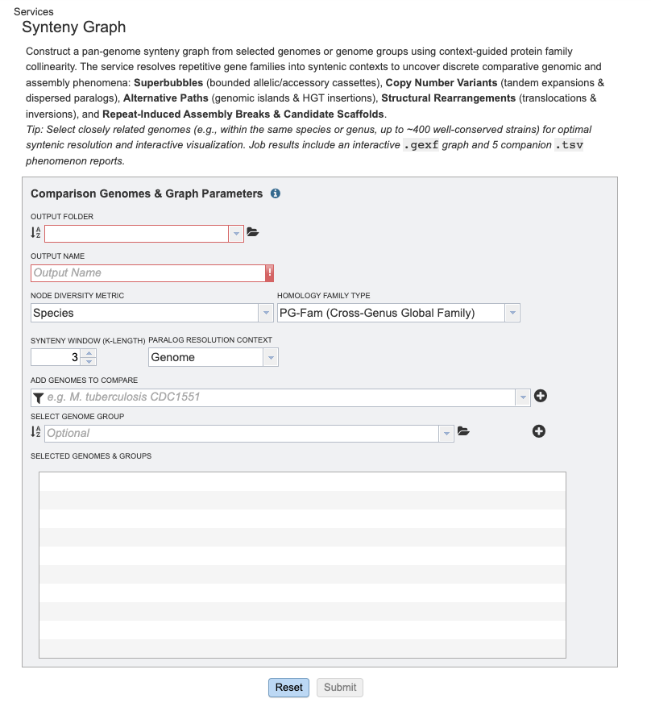
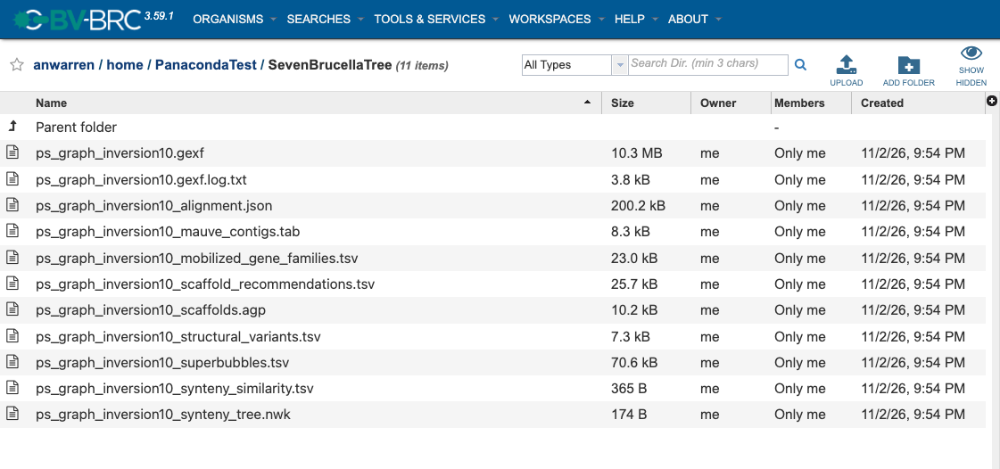
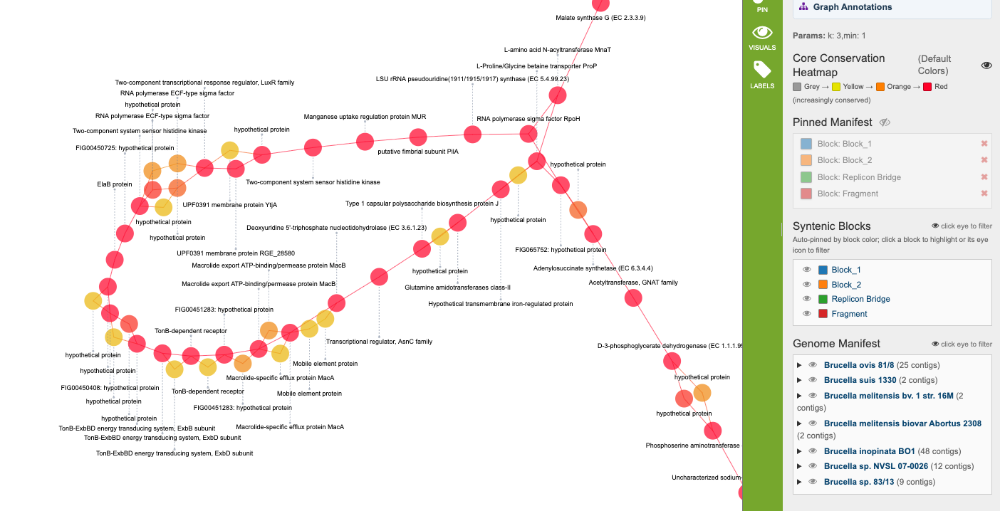
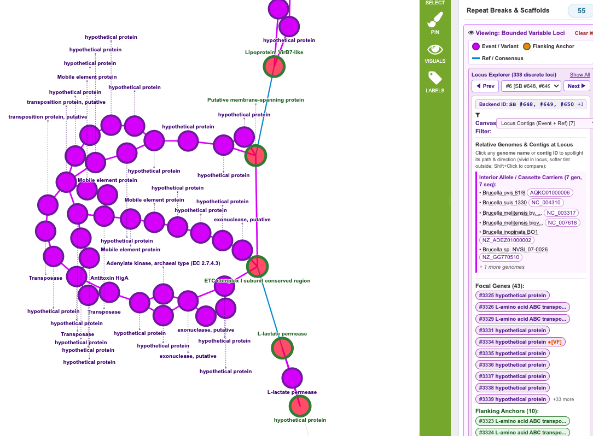
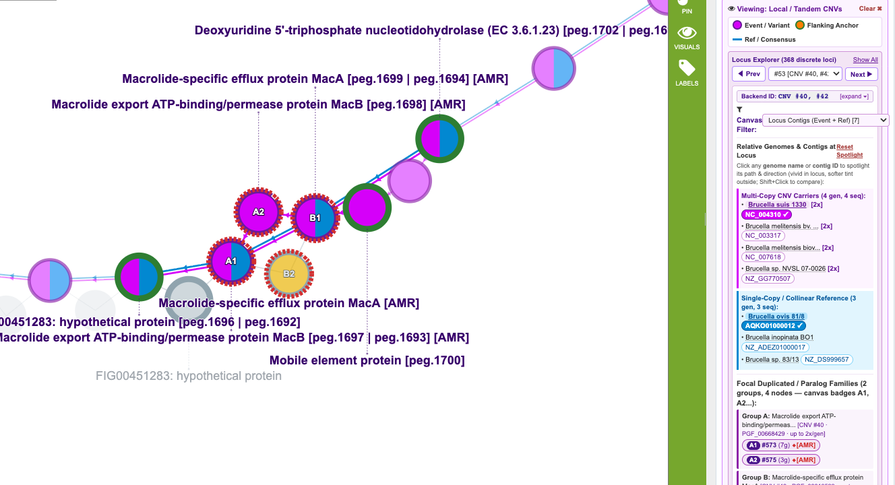
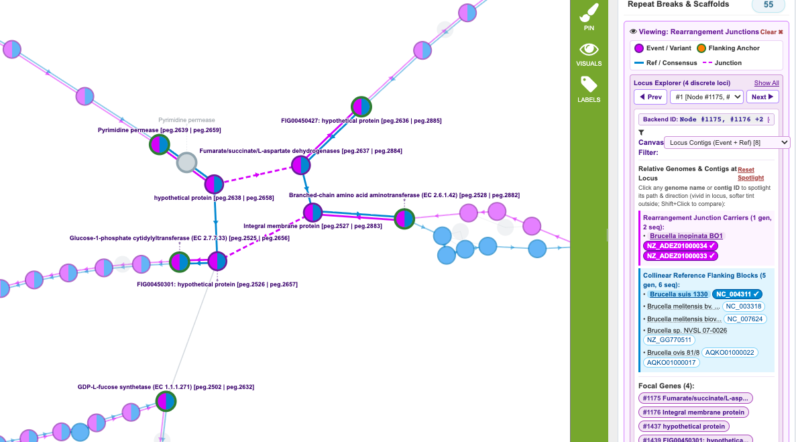
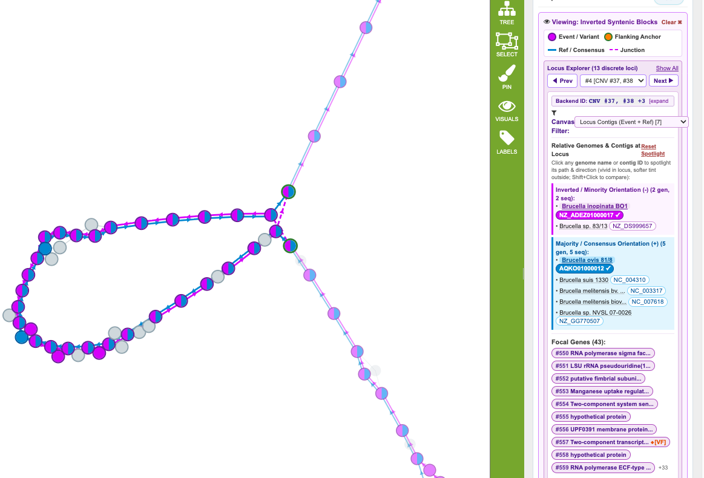
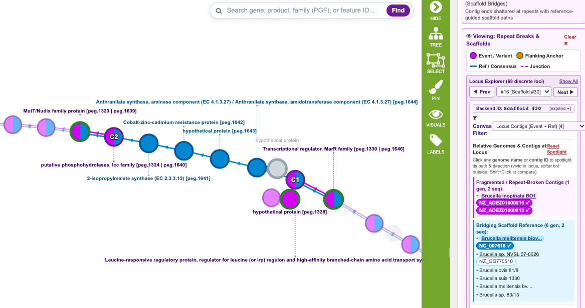

# Synteny Graph Service

## Overview
The Synteny Graph Service accepts annotated genomes or contigs and constructs a topological graph representing the conserved genomic architecture and structural variation across a population. By tracking protein families (e.g., PGFams, PLfams) as k-mers, the algorithm establishes unique "anchors" to resolve complex biological events. This approach provides a reference-free whole-genome comparison, explicitly identifying translocations, mobile element insertions, paralog expansions, and assembly gaps. 

## See also
  * [Synteny Graph Service](https://bv-brc.org/app/SyntenyGraph)
  * [Synteny Graph Service Tutorial](/tutorial/synteny/synteny_graph)

## Using the Synteny Graph Service
The **Synteny Graph** submenu option under the **Services** main menu (Genomics category) opens the Synteny Graph input form. *Note: You must be logged into BV-BRC to use this service.*

## Options

## Input Data
This service is designed to process groups of annotated genomes.

## Selected Genomes
Genomes placed here will be submitted to the service. You may select individual genomes or predefined Genome Groups from your BV-BRC workspace. 

## Parameters
The Synteny algorithm requires a few fundamental parameters to define how genomic conservation and variation are evaluated.

### Protein Family Type
The alphabet used to construct the graph. You can choose between **PGFams** (global cross-genus families), **PLfams** (local genus-specific families), or **FIGfams**.

### K-mer Size
The size of the continuous block of genes (k-mer) required to establish a syntenic neighborhood. The default is 3. Larger k-mers require longer stretches of perfect conservation to build the graph backbone.

### Minimum Sequence Support
The minimum number of genome sequences that must traverse a specific path for it to be included in the final graph output. The default is 1.

### Synteny Context
The tracking resolution used by the algorithm to evaluate structural conflicts:
*   **Genome:** (Default) Evaluates structural variations across the entire organism. Ideal for identifying plasmids, multi-replicon gene sharing, and whole-chromosome rearrangements.
*   **Contig:** Evaluates variations strictly within individual replicons. Ideal for studying purely intra-chromosomal events or circularization.
*   **Feature:** A purely topological A-Bruijn graph where all homologous genes collapse together, ignoring broader genomic context.

## Output Folder
The workspace folder where results will be placed.

## Output Name
Name used to uniquely identify results.

## Output Results

The Synteny Graph Service generates visualization-ready graph files alongside several tabular reports that catalog the exact topological phenomena discovered in the population.

### All Jobs Will Output
* **ps_graph.gexf** - The primary graph file, formatted for viewing natively in the BV-BRC workspace. Contains all rich metadata and boolean overlays.
* **ps_graph.gfa** - A Graphical Fragment Assembly (v1.1) file, ideal for viewing the linear path topology in tools like [Bandage](https://rrwick.github.io/Bandage/).
* **synteny_similarity.tsv** - A pairwise similarity matrix scoring genomes based on shared syntenic edges.
* **scaffold_recommendations.tsv** - A catalog of suggested connections to stitch together broken contigs based on population consensus.
* **mobilized_gene_families.tsv** - A catalog of gene families found distributed across multiple replicons or dispersed throughout the genome.
* **structural_variants.tsv** - A log of all specific edge junctions where the population diverges (insertions, translocations, etc.).
* **superbubbles.tsv** - A catalog of highly variable regions bounded by conserved core genes.

## Overall Concept: Graph Topology and Anchors

The Synteny graph is constructed using **Nodes** to represent unique protein families and **Edges** to represent physical adjacencies (genes sitting next to each other on a contig). 

The algorithm explores this graph using a "Thread-First Search." It identifies **Anchors**—unique, unambiguous blocks of genes—and pushes those structural signals through the graph. When different genomes present conflicting structural realities (or when the assembler fails), the algorithm dynamically resolves these topologies and tags the nodes and edges with specific biological classifications. 

The resulting topological phenomena are detailed below.

### Syntenic Blocks (Core Backbone)

The algorithm calculates "momentum" along the heaviest paths in the graph to identify the **Core Backbone**. Nodes and edges that form a continuous, uninterrupted consensus across the majority of genomes are grouped into specific Blocks (e.g., `Block_1`, `Block_2`). Regions that fall below a minimum density threshold are isolated as `Fragment`. 

### Superbubbles (Variation Hotspots)

A superbubble is a topologically bounded region where the graph diverges from a single "Entry" core gene into multiple different structural paths, before cleanly reconverging at a single "Exit" core gene. It isolates regions of high localized diversity bounded by strict synteny. 

### Paralogs & Repeats (CNVs)

This encompasses any gene family that exists in multiple copies within a single genome. The algorithm handles these mathematically based on their genomic context:
*   **Copy Number Variants:** When the set of genomes possesses adjacent paralogs of a gene of variable number.
*   **Fragmented CNV (Paralogs):** Copy number variants are scattered across different contigs or replicons in some genomes (basis of a CNV) and not in others.
*   **Repeat Ambiguity (Tandem Repeats):** When a genome possesses adjacent copies of a gene, the graph emits side-by-side nodes to prevent illogical topological loops. The edge routing between these nodes is an algorithmic artifact and is flagged as a `repeat_ambiguity_detour`.
*   **Fragmented Families (Dispersed/Multi-Replicon):** When a multi-copy gene is scattered across different contigs or replicons.
*   *For example:* An antimicrobial resistance (AMR) gene that exists on both the main chromosome and a mobile plasmid within the same strain.
*   **Graph Attributes:** Paralog families share a `cnv_cluster_id`. Individual nodes are classified as `repeat_ambiguity` or flagged with `is_fragmented_family = True`.

### Alternative Paths (Accessory Insertions)

An alternative path is a contiguous sequence of genes that bypasses the consensus backbone (e.g., a prophage or genomic island present in only a minority of the population). 

### Structural Rearrangements (Synteny Breakpoints)

A true structural rearrangement occurs when continuous anchors actively contradict each other, forcing the algorithm to declare a severe structural clash (e.g., non-allelic homologous recombination or massive chimeric misassemblies).

### Inverted Blocks

An inverted block represents a contiguous segment of genes that exists in both the forward orientation and the reverse-complement orientation in the population, appearing as figure-8 topologies in the graph.

### Assembly Breaks & Scaffolds

The graph identifies technical artifacts where a genome sequence shattered due to assembler limitations, and utilizes the unbroken synteny of other genomes in the population to provide a scaffold bridge across the gap.

---

## Workspace Actions and Launching the Viewer

After a Synteny Graph job completes, navigate to the output folder in your workspace. 

Selecting the **`ps_graph.gexf`** file will populate the vertical green Action Bar on the right side of the screen with file-specific actions:
*   **VIEW GRAPH:** Launches the interactive Synteny Graph Viewer to visualize and explore the network.
*   **Download:** Downloads the raw GEXF file.
*   **Copy / Move / Delete:** Standard workspace file management tools.

Selecting the top-level Job Folder will also reveal a **VIEW GRAPH** button, which automatically locates and opens the generated GEXF file.

---

## Synteny Graph Viewer Interface

Once the viewer is launched, the interface provides powerful tools to explore, color-code, and extract biological insights from the graph topology.

### The Main Canvas & Controls
*   **Canvas:** Click and drag to pan across the graph. Scroll the mouse wheel to zoom in and out. Click any node to open its details in the right-hand panel. Clicking the background deselects everything and restores the default view.
*   **Search:** Use the search bar in the top right to find specific genes or feature IDs.
*   **Left Toolbar:** Includes an Overview Map (mini-map) for quick navigation, Zoom buttons/slider, a Lens tool (magnifying glass), and a toggle to Show/Hide all edges.

### The Graph Details Panel (Right Sidebar)
When no nodes are selected, the right-hand panel acts as the master control center for the graph:
*   **Default Colors Toggle (Eyeball):** Mutes the embedded rainbow graph colors to a flat grey, allowing active highlights and custom pins to stand out brilliantly against the background.
*   **Pinned Manifest:** A persistent legend of all custom colors you have applied to nodes or paths. Clicking the eyeball icon temporarily mutes your pins.
*   **Graph Summary (Ontology Links):** A list of clickable "pill" badges detailing the specific structural variations in the population (e.g., *Superbubbles*, *Structural Rearrangements*). Clicking these buttons instantly highlights the affected nodes and edges in the graph. Hover over the text for biological definitions.
*   **Genome / Syntenic Block Manifests:** Expandable accordions listing all genomes, contigs, and syntenic blocks. Clicking these links will illuminate the exact path they take through the pan-genome network.

When a specific Node is clicked, the panel updates to display its metadata (Node ID, Diversity, Gene Family) alongside enriched links opening new tabs to the specific BV-BRC Feature or Genome pages.

### Viewer Action Bar
The green action bar on the far right controls the active selection in the graph viewer:
*   **HIDE / DETAILS:** Toggles the visibility of the Details Panel.
*   **COLOR:** Opens a color picker to persistently pin the currently selected node or highlighted path to a custom color (adding it to the Pinned Manifest).
*   **HL COLOR:** Sets an override color for temporary highlights (e.g., making all clicked paths glow Cyan instead of Magenta).
*   **BG COLOR:** Changes the background color of the entire canvas (useful for exporting images).
*   **RESET COLOR:** Erases all custom user pins and restores the graph to its default state.
*   **LABELS:** Toggles node text labels on/off and adjusts the label size multiplier for readability.
*   **FEATURE / GENOME:** If a node is selected, opens the standard BV-BRC Feature or Genome view in a new browser tab.

## Graph Properties: Nodes

* **`repeat_ambiguity`**
  * **Description:** True if a local Copy Number Variant (CNV) caused feature assignment ambiguity.
  * **How it is created:** When the algorithm detects a tandem duplication (a gene family repeating within a very short distance), for genomes with fewer copies there is ambiguity as to which instance of a gene should be assigned to which node depending on which alignment signal (anchor) is used. To preserve the full path of the genome with the most copies, the algorithm builds all of the side-by-side nodes for the repeated gene and applies this flag, noting that for the genomes with fewer CNVs there is an order-dependent assignment to the nodes.

* **`repeat_ambiguity_fragmentation`**
  * **Description:** True if Copy Number Variants are scattered across different contigs or replicons in some genomes and not in others.
  * **How it is created:** After the initial graph is built, the algorithm surveys all nodes that belong to the same underlying gene family. If it finds that any single genome possesses copies of this gene distributed across multiple different contigs (e.g., a chromosome and a plasmid), it flags the entire cluster to indicate a dispersed, multi-replicon gene family.

* **`synteny_breakpoint`**
  * **Description:** True if the anchors (seed alignments) contradict each other here, indicating a major structural rearrangement or a chimeric misassembly.
  * **How it is created:** When the algorithm traces the sequence paths from stable genomic anchors, two different continuous paths from the same genome may attempt to force a feature into a single node in a way that violates logical sequence order. The algorithm detects this impossible routing collision and flags the node as the exact epicenter where the synteny broke.

* **`assembly_repeat_break`**
  * **Description:** True if contig ends from the same genome collapsed together here at a shared repeat.
  * **How it is created:** Similar to a synteny breakpoint, but this triggers specifically when the conflicting paths both sit at the absolute terminal ends of broken contigs. Because the assembler shattered the DNA sequence and failed to provide flanking anchors to separate the copies, the algorithm is forced to collapse the ragged ends into a single node.

* **`alternative_path`**
  * **Description:** True if this is an internal node of an accessory insertion or secondary structural route.
  * **How it is created:** The algorithm traces all paths between two conserved anchor points and identifies the "consensus" highway used by the majority of the population. It then identifies paths taken by a minority of genomes. The internal nodes of these minority paths (representing genomic islands, prophages, or indels) receive this flag.

* **`is_scaffold_path`**
  * **Description:** True if this continuous gene bridges an assembly gap for another genome.
  * **How it is created:** The algorithm finds a genome whose sequence is physically broken across two separate contigs. It then looks at the rest of the population and finds intact genomes that possess continuous genes bridging that exact gap. It flags the bridging nodes in the intact genomes as potential scaffold material.

* **`is_superbubble`**
  * **Description:** True if this node sits inside a superbubble (a highly variable evolutionary hotspot).
  * **How it is created:** The algorithm identifies regions where the graph diverges from a single "Entry" core gene into multiple different structural paths, and cleanly reconverges at a single "Exit" core gene. The internal nodes trapped within this bounded, multi-path region receive this flag.

* **`block`**
  * **Description:** Documents which synteny block the node belongs to (generally corresponding to a composite replicon or core chromosomal backbone).
  * **How it is created:** Assigned by propagating a "momentum" signal along heavily weighted edges. The signal halts entirely when it reaches structural junctions (like breakpoints or accessory integrations) to prevent fusing distinct chromosomal backbones together.

* **`length`**
  * **Description:** The average/median nucleotide length of the features on the node.
  * **How it is created:** Calculated by taking the sum of the physical nucleotide lengths of all individual gene sequences assigned to the node, divided by the total number of features.

* **`cnv_cluster_id`** *(Integer)*
  * **Description:** An ID linking all nodes that belong to the same underlying paralogous gene family.
  * **How it is created:** When repeats or ambiguities force the algorithm to split a single gene family across multiple distinct topological nodes, it assigns them all the same ID to remember their shared biological origin.

* **`diversity`** *(Float)*
  * **Description:** A metric of the taxonomic diversity of the genomes present in this node.
  * **How it is created:** Calculated by dividing the number of unique taxonomic lineages (e.g., species) present in the node by the total number of distinct taxonomic lineages analyzed in the entire dataset.

---

## Graph Properties: Edges

* **`repeat_ambiguity_detour`**
  * **Description:** True if a genome bypassed a direct edge because of a CNV ambiguity.
  * **How it is created:** When the algorithm builds multiple parallel nodes to handle a tandem repeat, single-copy genomes are arbitrarily routed through one of those nodes. This flag is applied to edge "drop-outs" to clarify that the genome simply took a parallel lane in the repeat structure, rather than undergoing a true biological deletion.

* **`repeat_fragmentation_junction`**
  * **Description:** True if this edge is the physical link of a CNV-scattered gene on different contigs.
  * **How it is created:** When a genome possesses the genes on both sides of a potential edge, but drops out of the edge specifically because the connected node is part of a `repeat_ambiguity_fragmentation` cluster. It highlights the flanking connection point of a gene that has mobilized (e.g., to a plasmid).

* **`breakpoint_junction`**
  * **Description:** True if this edge is the severed or newly formed linkage of a structural rearrangement.
  * **How it is created:** When an edge drop-out involves a `synteny_breakpoint` node. It flags the exact location where an ancestral continuous path was broken by an inversion, translocation, or recombination event.

* **`alt_path_junction`**
  * **Description:** True if this edge is the integration boundary of an accessory island.
  * **How it is created:** Applied specifically to the Entry and Exit edges that connect an `alternative_path` (a minority sequence or genomic island) back to the main consensus backbone.

* **`alternative_path`**
  * **Description:** True if this edge is the internal wiring of an accessory island.
  * **How it is created:** Applied to the internal edges connecting the nodes within a minority insertion path, complementing the node-level flag.

* **`is_scaffold_path`**
  * **Description:** True if this edge bridges a broken assembly (capturing both 0-gene gaps and multi-gene paths).
  * **How it is created:** Applied when a continuous genome provides a direct edge between two terminal contig ends in another genome (0-gene gap), or applied to the edges that make up a multi-gene bridging path between broken contigs.

* **`inverted_block`**
  * **Description:** True if this edge was traversed in both forward and reverse-complement orientations by different genomes.
  * **How it is created:** The algorithm dynamically reverse-complements inverted sequences to align homologous genes. As a result, edges inside an inversion are traversed in opposite directions by different genomes, generating bidirectional edges in the directed graph. When converted to an undirected graph, these are flagged as inverted.

* **`is_superbubble`**
  * **Description:** True if this edge sits inside a superbubble.
  * **How it is created:** Applied to all internal wiring and the specific entry/exit edges of a multi-path variable locus, ensuring that direct bypass routes (where a genome skips the inserted genes entirely) are also captured as valid alleles of the superbubble.
