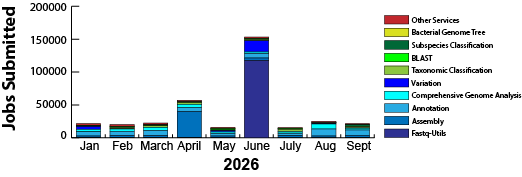

# Usage Metrics
For October 2026, unless otherwise noted

| Metric                                          | Value     |
| :---------------------------------------------  | :-------: |
| Total registered users                          |    84,820 |
| Analysis jobs submitted by users                |	   11,568 |
| Registered users that run a service             |     1,554 |
| Total storage used for user data (TB)           |     951.5 |
| Total site visits                               |    68,441 |
| Total unique visitors (avg/month)               |    46,602 |
| Total pageviews                                 |   131,993 |                      
| Avg. pages / visit                              |      1.92 |
| Avg. visits / visitor                           |      1.46 |
| Avg. visit duration (seconds)                   |       272 | 
| Citations to BV-BRC publications (cumulative)   |    31,305 |

 
 

**Analysis jobs submitted by users, by type**

